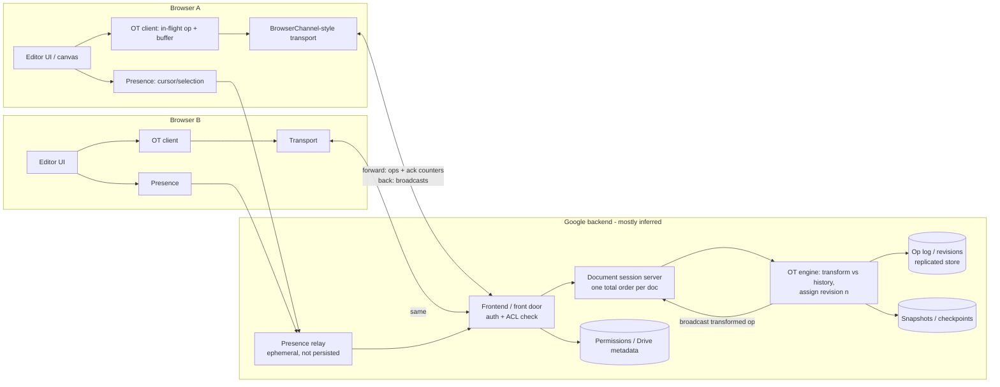

# Google Docs real-time collaboration: end to end

Research date: 2026-10-10. Audience: Hacklanta team (Creative track), exploring a live collaborative session for After Effects.

## Evidence legend
- **[documented]**: stated in a primary source (Google blog or docs, an academic paper, the Apache Wave whitepaper).
- **[inferred]**: a reasonable reconstruction. Google has not published it.
- **[snippet-only]**: I saw the claim only in a search-result summary and could not open the page body.
- **[uncertain]**: sources conflict, or the source is weak.

**Caveat on sourcing.** The three core Google engineering posts (Sept 2010) loaded in WebFetch as title and navigation only, with no body text. I tried the drive.googleblog.com and cloud.googleblog.com versions, plus a PDF copy. The Jupiter paper PDF came back as unreadable compressed data. What I know about those documents comes from search-result summaries and from adjacent primary sources I could open: the Apache Wave OT whitepaper, the UIST'95 abstract, the Docs API reference, the Drive support pages, and Google's Realtime API deprecation notice. Google has never published Docs' server internals, so many boxes in the diagram below are **[inferred]**.

---

## 1. Summary (the 30-second version)

1. Docs uses **Operational Transformation (OT)** with a **central server that decides the order of edits**. [documented] (Google's 2010 blog series; the OT method also appears in the Realtime API launch coverage).
2. Document state is a **log of revisions**. Each revision is a list of primitive changes: insert text, delete text, apply style. [documented, snippet-only for the "three types" phrasing]
3. Each client applies its own edits **immediately** (optimistic UI). The server transforms and orders them. Clients transform incoming remote ops against their unacknowledged local ops. [documented in the Jupiter and Wave lineage; assumed to apply to Docs, so **[inferred]** for Docs specifically]
4. The transport is **HTTP-based, BrowserChannel-style long polling** historically. I found no current official statement of what Docs uses today. [uncertain]
5. Presence (cursors, selections, who is online) is **ephemeral**. It is separate from the document log. [documented that cursors are shown in collaborator colors; the architecture is **[inferred]**]
6. Offline mode is a Chrome/Edge extension (Docs Offline) that keeps recently opened or pinned docs locally. Edits sync on reconnect. Real-time collaboration is disabled while offline. [documented]

---

## 2. Operational Transformation and the Jupiter lineage

### 2.1 Why OT
Two people edit "ABC" at once. User 1 inserts "X" at index 0. User 2 deletes index 2 ("C"). If each applies the other's op as-is, the replicas can diverge, because the index meanings shifted. OT rewrites an incoming op against ops that happened concurrently, so every replica converges to the same text while preserving intent.

Google's blog series (Sept 2010) frames it as two problems. OT avoids conflicting edits. A separate **collaboration protocol** makes sure many simultaneous changes are merged correctly. [documented, snippet-only: Drive blog posts "Conflict resolution" (22 Sep 2010) and "Making collaboration fast" (23 Sep 2010), and the "Working together, even apart" summary (28 Sep 2010)]

### 2.2 Jupiter (Xerox PARC, 1995)
- Paper: Nichols, Curtis, Dixon, Lamping, "High-Latency, Low-Bandwidth Windowing in the Jupiter Collaboration System", UIST '95, pp. 111-120. [documented via the UIST abstract page; I could not read the full text]
- A **central server holds the world state**. Clients send high-level widget events. [documented]
- Concurrency control is adapted from Ellis & Gibbs' fully distributed optimistic algorithm. **The central server lets the authors simplify it.** The result gives "serializable update streams and fast response to user actions". [documented]
- Operation transformations adjust conflicting messages so all widget instances converge. The authors note the best transformations are not always obvious and depend on competing concerns. [documented]

**What the "Jupiter-style" simplification means** (standard description from the OT literature and consistent with the Wave whitepaper below; I could not read the Jupiter paper text itself): instead of every peer tracking every other peer (an N-way vector clock), the server keeps **one linear history**, and each client talks to the server over a **two-party** link. Each client/server pair only has to transform against each other, tracking how many messages each side has sent and received. [inferred from the paper's abstract plus the Wave whitepaper]

### 2.3 Google Wave's OT whitepaper: the best primary description of the protocol
Wave (2009-2010) came from the same Google team lineage. The Apache-hosted whitepaper "Operational Transform" (Wang, Mah, Lassen, v1.1, July 2010) is the best available description of a Jupiter-derived Google protocol. [documented; opened]

- **Clients wait for acknowledgement from the server before sending more operations.** An ack means the server transformed, applied, and broadcast the op.
- While waiting, the client **composes all pending ops into one**, reducing the number of ops to transform and send. This is the batching mechanism.
- The server keeps **one state space** (the history of applied ops). It transforms each incoming client op against that history, applies it, and broadcasts it.
- Because of the ack rule, client ops always lie on the server's OT path. Clients see remote changes in chunks roughly one round trip apart.
- Document ops are streaming, SAX-like sequences of retain / insert / delete / annotation-boundary components. Composing two composable ops yields one op.
- Local edits execute immediately, with no locking or blocking.

Caveat: this is **Wave**, not Docs. Docs is widely understood to use the same family of approach, and Wave's OT work reused Docs-adjacent ideas, but I found no Google statement that Docs runs this exact protocol. Treat the Docs mapping as **[inferred]**.

### 2.4 Client-side state machine (Jupiter / Wave style) [documented for Wave; inferred for Docs]

```
Client states:
  SYNCED        no unacked local op
  AWAITING_ACK  one op in flight; further local edits get composed into a buffer
  
 local edit:
   SYNCED       -> apply locally, send op,        go AWAITING_ACK
   AWAITING_ACK -> apply locally, compose into buffer
 server ack:
   AWAITING_ACK with empty buffer -> SYNCED
   AWAITING_ACK with buffer       -> send buffer as one op, stay AWAITING_ACK
 remote op arrives (server-ordered):
   transform remote against (in-flight, buffer) and transform those against remote,
   then apply the transformed remote locally
```

This is the same shape as the open-source ot.js and ShareDB clients. It is a well-known pattern, shown here as an illustration rather than as Google source code.

---

## 3. Server-authoritative ordering and revisions

- The server assigns a **total order** to ops. Each accepted op produces a new **revision number**. [documented for Wave; the Docs API exposes `revisionId`, so revisions certainly exist in Docs]
- **Docs API evidence of server-side merging.** `documents.batchUpdate` accepts a `WriteControl` with one of two modes. [documented; opened]
  - `requiredRevisionId`: if the document changed since you read it, the write fails with a 400.
  - `targetRevisionId`: the server applies your changes on top of collaborators' changes ("the API client can be thought of as another collaborator"; "the Docs server is responsible for merging the content"). The target must be recent. Revision IDs stay usable for several minutes, less on busy docs.
  - A batch is atomic. If any request is invalid, none are applied.
  - This is the strongest primary evidence that Docs is **server-merged OT with revision-based rebasing**. The `targetRevisionId` behavior is exactly "transform my ops from base revision N against revisions N+1..latest."
- **Revision history (user-facing).** Drive creates a new revision entry each time content of a Docs/Sheets/Slides file changes. Users can name versions. [documented, snippet-only: Drive API change overview; third-party pages for the UI]. Whether the underlying store is "the op log itself" or snapshots is **[uncertain]**. Because the model is an op log (see §2.1), replaying ops is the natural storage. Periodic snapshots/checkpoints are a standard optimization and are **[inferred]**.
- **Undo** is per-user: it inverts only your own ops and transforms the inverse against others' ops. [documented for the Realtime API: "automatically resolves potential conflicts from overlapping edits by collaborators to undo only the local changes", snippet-only, Google April 2013 post]. The same behavior is observable in Docs. Inferred to be the same engine.

---

## 4. How edits are batched and sent

| Layer | What we know | Status |
|---|---|---|
| Batching | Wave-style clients compose pending ops while an op is in flight. One op is in flight at a time. | documented for Wave, inferred for Docs |
| Typing granularity | Docs shows others' changes character by character as typed ("see other people's changes character-by-character"). Up to 50 simultaneous editors were advertised in 2010. | documented, snippet-only (Sept 2010 blog summary) |
| Transport | Google's BrowserChannel (in the Closure library) provides two virtual channels, a *forward* channel (client to server, HTTP requests) and a *back* channel (server to client, long-lived hanging GET / streaming). Third parties describe it as Gmail-chat-era long polling that works through proxies, with no WebSocket required. | BrowserChannel protocol: documented by third-party mirrors only; **that Docs uses it today: [uncertain]**. Firestore's SDK still uses the successor "WebChannel", with a default 30 s hanging GET in long-poll mode (Firebase docs, snippet-only) |
| Fallback | Retry and timeout constants for back/forward channels exist in Closure API docs (reconnect with backoff) | snippet-only |
| WebSocket | No primary Google source confirms Docs uses WebSockets. | [uncertain] |
| Payload | Small JSON-ish messages carrying ops plus revision/ack counters. | [inferred] |

Design point worth copying: a single in-flight op plus a composed buffer self-throttles the traffic to roughly one message per round trip, regardless of typing speed.

---

## 5. Presence and cursors

- Collaborators' cursors appear in a per-user color that matches the color next to their name in the chat box/user list. [documented, snippet-only: Drive blog "Online office hours with Google Docs", Oct 2010]
- The Realtime API exposed **presence events** for collaborators joining and leaving. [documented, snippet-only]
- Architecture (separate ephemeral channel, positions stored as indices that must be transformed against remote edits, broadcast periodically, not persisted) comes only from third-party system-design write-ups. **[inferred]**, but it is the standard design and the only sensible one: a cursor position is a position in the document, so it has to go through the same transformation as any index, otherwise it points at the wrong character after a remote insert.

---

## 6. Offline mode and reconnect merge

Documented in Google's support page (opened, https://support.google.com/docs/answer/6388102):
- Requires Chrome or Microsoft Edge plus the Google Docs Offline extension. Turn on while online. No private browsing. One account per browser profile. Admins can disable it.
- Recently opened files are saved locally, and specific files can be marked "available offline."
- Auto-enabled on ChromeOS or with Drive for desktop.
- Very large files may fail to sync, and some docs may not be ready for offline use.

Not documented by Google: the local store format (one low-quality source says IndexedDB, **[uncertain]**) and the merge algorithm on reconnect. The natural design is that offline edits form a long chain of unacked local ops, and on reconnect the client sends the composed op based on the last-known server revision. The server then transforms it against everything that happened meanwhile, which is exactly the `targetRevisionId` behavior. **[inferred]** Real-time collaboration (seeing others' cursors/edits) is unavailable offline. [documented, snippet-only]

---

## 7. Conflict resolution and latency handling

- **Convergence**: guaranteed by OT transformation properties plus the server's total order. Concurrent inserts at the same position are tie-broken deterministically (for example by server arrival order). [inferred; standard OT, consistent with Jupiter's serialized stream]
- **Intent preservation**: ops are semantic (insert / delete / style on a range), not "set the document to this text". Concurrent edits rarely lose data. A deleted range that someone else typed into is the classic edge case. [inferred]
- **Latency hiding**: the local edit is applied before the server round trip (optimistic). The Jupiter paper's title is literally about high-latency, low-bandwidth operation, and fast local response is its stated payoff. [documented]
- **Remote latency**: other users' edits arrive about one RTT plus processing late, in chunks. [documented in the Wave whitepaper]
- **Hard conflicts** (the same character being formatted two ways, for example) resolve by last-writer-in-server-order. [inferred]

---

## 8. Scaling and storage

Google has not published Docs' storage architecture. What can be said:

- **Spanner** (OSDI 2012) is described as Google's scalable, multi-version, globally distributed, synchronously replicated database. The paper's first customer was F1 (ads). I found **no source naming Docs or Drive as a Spanner user** and no source for a Bigtable-for-Docs claim. Do not claim either. [uncertain / not found]
- A plausible design is per-document sharding: each document is owned by a single logical server process (the "session" or "document actor") that serializes ops, with the op log persisted to a replicated store. This follows from the server-authoritative model: one total order per document means one writer per document. The Wave architecture whitepaper's per-wavelet concurrency scope ("concurrency control and OT are applied at the level of wavelets, not whole waves") supports the idea that the unit of serialization is a document, not the whole system. [inferred]
- Scale-out then comes from having very many independent documents, with the few busy documents capped at a limited editor count (50 editors in 2010 [documented, snippet-only]).

---

## 9. Permissions

- Roles seen in Docs and the Drive API: owner, editor (writer), commenter, viewer (reader), plus link sharing and domain restriction. [documented in general; I could not open the Drive permissions guide, which returned 404, so treat the exact role list as common knowledge rather than a citation from this run]
- The Docs `writeMode` `SUGGEST` shows suggestions as a first-class mode alongside `EDIT`. [documented]
- Enforcement point: the server checks permission when a session opens and on each op submission. [inferred]. The Wave whitepaper says the host server validates ops before applying them. [documented for Wave]

---

## 10. Drive Realtime API history (the productized version)

| Date | Event | Source status |
|---|---|---|
| Mar 2013 | Google launches Drive Realtime API: collaborative maps, lists, strings, JSON values, custom objects/references. Handles "network communication, storage, presence, conflict resolution". Based on OT. | snippet-only (TechCrunch, InformationWeek, APIEvangelist coverage) |
| 30 Apr 2013 | New features incl. undo/redo, which undoes only local changes. | snippet-only (post body didn't load) |
| 28 Nov 2017 | Retirement announced. No new projects. | documented (opened) |
| 11 Dec 2018 | Documents become read-only. | documented (opened) |
| 15 Jan 2019 | API shut down. A JSON export API stays available. | documented (opened) |

Google's suggested alternatives: Cloud SQL, Firebase Realtime Database, Cloud Firestore, with a migration guide to Firestore. They are "not direct equivalents". Third parties such as MindMup said no suitable collaborative-editing replacement existed that kept data in Drive. [documented, opened + snippet-only for MindMup]

**Lesson**: Google productized OT-as-a-service and then killed it. The hard parts (the per-app transform functions, the server operations burden) did not pay off as a general platform. Teams went to Firebase-style last-writer-wins or to CRDT libraries.

---

## 11. System diagram



Flow of one keystroke:
```
A types "x"  -> A applies locally (instant) -> A sends op(base=rev 41) if none in flight
Server: transform op against any ops after rev 41 -> append as rev 42 -> persist
Server: ack to A (rev 42) ; broadcast transformed op to B, C...
B: transform incoming op against B's unacked local ops -> apply
```

---

## 12. Component list

| # | Component | Role | Status |
|---|---|---|---|
| 1 | Rich editor model (ops: insert/delete/style) | Defines the primitive operations that get transformed | documented (3 basic types, snippet-only) |
| 2 | OT client (in-flight op + composed buffer) | Optimistic local apply, batching, remote-op transformation | documented for Wave, inferred for Docs |
| 3 | Transport (BrowserChannel / WebChannel-like) | Two virtual channels over HTTP, with retry | third-party docs; use in Docs uncertain |
| 4 | Frontend with auth and ACL | Authenticate, authorize read/comment/edit | inferred |
| 5 | Per-document session server | Single serializer of ops, so there is a total order | inferred (supported by the Docs API revision semantics) |
| 6 | OT engine (server) | Transform against history, assign revisions, validate | documented for Wave |
| 7 | Op log and snapshot store | Revisions, version history, recovery | the revision concept is documented; storage tech not documented |
| 8 | Presence relay | Cursors, selections, join/leave | colors documented; architecture inferred |
| 9 | Offline cache and extension | Local copy plus sync on reconnect | documented (support page) |
| 10 | Drive metadata and sharing | Files, permissions, revision listing | documented (Drive API) |
| 11 | Comments / suggestions | Anchored annotations, `SUGGEST` write mode | partly documented |

---

## Implications for our After Effects live-session idea

**Key difference first.** Docs edits a *linear text sequence* with three primitive ops. After Effects is a *project graph*: compositions, layers, effects, keyframes, expressions, plus huge binary media and **expensive rendered frames**. OT's transform functions are what make Docs work, and writing a correct transform for every pair of AE operations is not feasible in a hackathon. Take Docs' *architecture* and drop its *algorithm*.

### Server vs host architecture
1. **Authoritative ordering is the thing to copy, and it works with a host.** Docs' key property is one component that assigns a total order and revision number. That component can be the **host's machine** instead of a Google datacenter. Host = the "document session server". Guests = OT-style clients. A relay is still needed for NAT traversal, but it can be a dumb pipe and does not need to understand the document. This matches the Jupiter lineage: a two-party link between each client and one central node is exactly the simplification Jupiter made over fully peer-to-peer.
2. **Host-authoritative is good for AE specifically** because the host holds the project file, the media, and the GPU. Rendering and previews stay on the host and get streamed to guests (cheap for guests, no media sync).
3. **Cost of host-based**: the session dies if the host disconnects (Docs has no such problem). Mitigate with a periodic snapshot saved to a small server or to the guest, and make the project file on the host the source of truth. A server-only design gives persistence and permissions but means shipping gigabytes of media, which is the wrong trade for AE.
4. **Recommended hybrid for a demo**: a thin cloud service for **signalling, auth, and session codes** (the "start a session, friend joins" UX), and a **host-authoritative session** for edits and video. Persistence can wait.

### Features this enables (cheap, copy from Docs)
- **Optimistic local apply, one op in flight, composed buffer.** Guests' timeline/property edits feel instant; the host acks. At property granularity (set layer 3 position to X), you can use **last-writer-wins per property in host order** instead of OT. This is the pragmatic version of the same idea and is **[inferred]** to cover most real AE edits.
- **Presence**: colored cursors, selected layer/keyframe highlighted per user, playhead per user. Ephemeral, never persisted, throttled to roughly 10-30 Hz. This is the most visible, lowest-risk feature for judges.
- **Per-user undo** (undo only my own ops) mirrors Docs and the Realtime API behavior, and avoids guests undoing each other's work.
- **Revision log**: keep an append-only op log on the host with revision numbers. It gives version history, a "what changed" feed, and reconnect catch-up ("send me ops after rev N") for nearly free.
- **Roles**: owner/host, editor, commenter, viewer, enforced by the host before it applies an op. Guest "suggest" mode (like `SUGGEST`) is a nice stretch feature: edits are queued as proposals that the host accepts.
- **Locks as a cheap alternative to OT**: lock-by-layer/comp (soft, visible in presence) removes most conflicts. Docs does not do this, but it is the standard answer when operations are too complex to transform.

### Features this rules out or makes hard
- **True offline merge** for guests. Docs can do it because its ops are transformable. For AE, support reconnect catch-up only, not long offline divergence.
- **Everyone-edits-concurrently on the same property or text** with perfect intent preservation. Expect last-writer-wins and visible flicker. Say so in the pitch rather than hiding it.
- **Real-time co-editing of expression/script text** can use a real OT/CRDT library (for example ShareDB, Yjs, Automerge) for those text fields only. That is a sensible add-on, not core.
- **Docs-style hosted scale** (50 editors) is out of scope. Plan for 2-4 people.
- **Realtime API-style generic service**: Google shut it down after about six years (2013-2019). Do not build a generic collaboration platform. Build one tight AE demo.

### Open questions for the team
- Does the AE integration (CEP/UXP panel or ExtendScript) expose enough change events to build an op stream? Docs' model depends on getting every edit as a discrete op. If AE can only be polled or diffed, we need a diff-based approach, which is a separate research item.
- Do we stream rendered frames from the host (guests see exactly what the host sees) or sync the project and let guests render locally? Host-streaming is much simpler and fits the "fastest GPU hosts" premise.

---

## Sources

Opened and read (full or partial):
- Apache Wave, "Operational Transform" whitepaper (Wang, Mah, Lassen, v1.1, July 2010): https://svn.apache.org/repos/asf/incubator/wave/trunk/whitepapers/operational-transform/operational-transform.html?p=1400000
- UIST '95 abstract, Nichols/Curtis/Dixon/Lamping, "High-Latency, Low-Bandwidth Windowing in the Jupiter Collaboration System": https://uist.acm.org/uist1995/abstracts/Nichols.html
- Google Docs API, `documents.batchUpdate` reference (WriteControl): https://developers.google.com/docs/api/reference/rest/v1/documents/batchUpdate
- Google Docs API best practices (concurrent edits): https://developers.google.com/docs/api/how-tos/best-practices
- Google Docs Editors Help, offline access: https://support.google.com/docs/answer/6388102
- Google Workspace Updates, 28 Nov 2017, "Committed to storage APIs retiring" (Realtime API shutdown): https://workspaceupdates.googleblog.com/2017/11/committed-to-storage-apis-retiring.html

Search-result summary only [snippet-only]; page bodies did not load or were not readable:
- Drive blog, 22 Sep 2010, "What's different about the new Google Docs: Conflict resolution": https://drive.googleblog.com/2010/09/whats-different-about-new-google-docs_22.html
- Drive blog, 23 Sep 2010, "Making collaboration fast": https://drive.googleblog.com/2010/09/whats-different-about-new-google-docs.html
- Google Cloud blog, 28 Sep 2010, "Working together, even apart": https://cloud.googleblog.com/2010/09/whats-different-about-new-google-docs.html
- Jupiter paper PDF (unreadable compressed stream in WebFetch): https://lively-kernel.org/repository/webwerkstatt2011/projects/Collaboration/paper/Jupiter.pdf
- 2010 Google Docs OT PDF mirror (unreadable in WebFetch): https://idl.uw.edu/future-scholarly-communication/files/2010-GoogleDocs-OT.pdf
- Drive blog, Oct 2010, "Online office hours with Google Docs" (cursor colors): https://drive.googleblog.com/2010/10/online-office-hours-with-google-docs.html
- G Suite Developers blog, 30 Apr 2013, "New features for Google Drive Realtime" (undo/redo): https://gsuite-developers.googleblog.com/2013/04/new-features-for-google-drive-realtime.html
- Realtime API launch coverage, Mar 2013: https://techcrunch.com/?p=780621 , https://www.informationweek.com/it-leadership/google-releases-realtime-api-for-drive-apps , https://www.apievangelist.com/2013/03/19/google-launches-real-time-api-and-javascript-library/
- MindMup note on Realtime API deprecation: https://www.mindmup.com/help/guides/google_realtime_deprecation/
- Drive API change overview (revisions): https://developers.google.com/workspace/drive/api/guides/change-overview
- Spanner, OSDI 2012: https://research.google.com/archive/spanner.html
- Firebase `ExperimentalLongPollingOptions` (WebChannel long-poll, 30 s): https://firebase.google.com/docs/reference/js/firestore_.experimentallongpollingoptions.md
- BrowserChannel third-party descriptions: https://www.npmjs.com/package/browserchannel , https://www.github.com/aalexand/wc , https://m.seehuhn.de/data/jvjsdoc/example/goog/net/BrowserChannel.html
- Xebia, "Understanding Google Wave": https://xebia.com/blog/understanding-google-wave/
- Wave architecture whitepaper (Lassen): https://svn.apache.org/repos/asf/incubator/wave/tags/wave-0.4-rc1/whitepapers/google-wave-architecture/google-wave-architecture.html
- Third-party system-design write-ups used only for the **[inferred]** presence design: https://blog.algomaster.io/p/google-docs-system-design-interview , https://www.techinterview.org/post/3233460997/system-design-collaborative-editing/?format=md

Failed to open: Drive permissions guide (https://developers.google.com/workspace/drive/api/guides/about-permissions, 404); an earlier URL for the Wave OT whitepaper without the `?p=` suffix (404).
