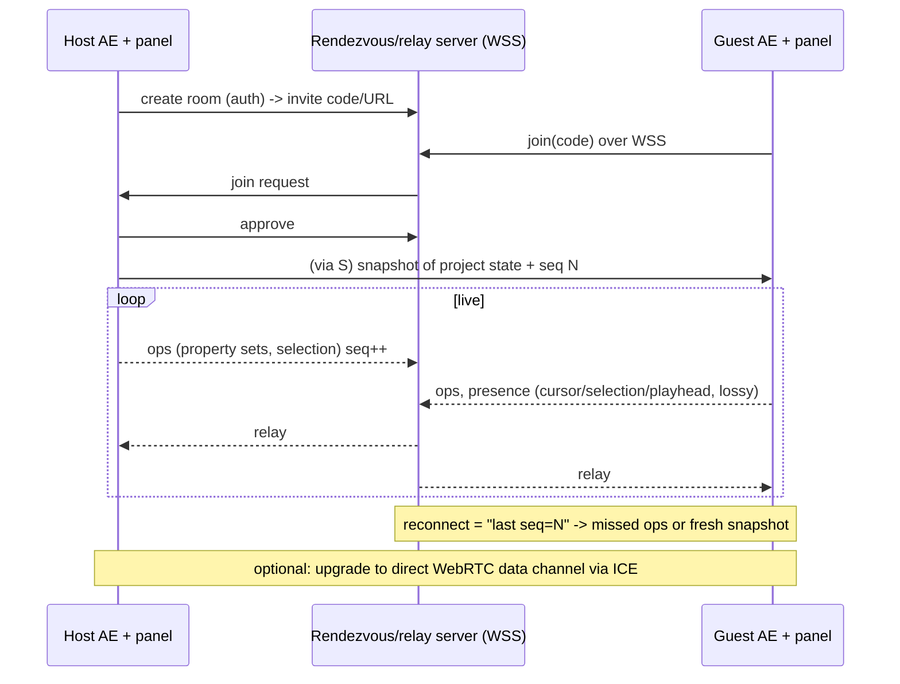

# 03 - Networking components and server-vs-host models for a live After Effects session

Researched 2026-10-10. Scope: how to connect two real After Effects (AE) instances over a network, and whether to use a central server, a host-local session, or a hybrid. Reference feature set is the "Collabify" promo (see `research/tiktok-collabify-observations.md`). That promo is a feature reference only. It shows two AE windows on the same `Brand_Launch_v3.aep`, an Invite collaborator button, Not connected -> Connected, the other person's labeled cursor, layers and changes, and a Rendering badge. It does not show how any of this works.

Legend: **[snippet-only]** = only a search snippet was read, page not opened. **[uncertain]** = inference or unsourced general knowledge. Unmarked claims come from a page I opened.

---

## 1. TL;DR

- Collabify's visuals imply **per-machine state/event sync** (both machines run AE, each with the project). That is option (1) below. A screen stream (option 2) would show one AE window, not two.
- The hard part is **not networking**. It is that **AE has no change-notification API** for scripts/panels (section 6). Whichever transport you choose, you must detect edits by polling or by a C++ AEGP plugin, then apply remote edits by scripting.
- Recommended architecture for a hackathon: **hybrid with a tiny signaling/relay server** (a hosted WebSocket relay with room codes, which also handles invites and presence), with the host holding the authoritative project state. Do not do a pure host-local server that guests must reach directly. That needs port forwarding or a tunnel, which is the biggest setup-friction risk.
- Offer **GPU-desktop streaming (Parsec / Sunshine+Moonlight)** as an optional "watch/drive the host's screen" mode, not as the core. It solves the "host has the fast GPU" story but cannot produce two independent windows or labeled cursors.

---

## 2. Topology options

```
(A) Central authoritative server            (B) Host-authoritative (listen server)
    Editor1 --\                                  Guest --> Host (runs session locally)
    Editor2 ---+--> Cloud server (truth)         Guest must REACH host:
    Editor3 --/    + DB, auth, history           port-forward / tunnel / VPN / ICE

(C) P2P mesh                                (D) Hybrid: signaling + relay, host holds truth
    E1 <--> E2                                   Host --ws--> Rendezvous server <--ws-- Guest
    E1 <--> E3   (n*(n-1)/2 links)                  (room code, auth, presence, fallback relay)
    E2 <--> E3                                   optional: upgrade to direct WebRTC / tunnel
```

| Model | Who is authoritative | Fits 2 editors? | Notes |
|---|---|---|---|
| A. Central server | Server | Yes | Figma's model: "the server can define the order of events", clients can't reject server changes ([Figma](https://www.figma.com/blog/how-figmas-multiplayer-technology-works/)). Costs hosting, adds a hop, needs the project asset files stored somewhere. |
| B. Host-authoritative | The host's machine | Yes | Zero server cost; host's LAN IP is not reachable from the internet by default (section 4). |
| C. P2P mesh | Nobody (CRDT) | Yes, awkward beyond ~4 | Needs signaling anyway (section 3). Pairs naturally with CRDTs. |
| D. Hybrid | Host (or CRDT) | Yes | Server only does rendezvous + dumb relay. Cheap, no port forwarding for users. |

---

## 3. Transport components

### 3.1 WebSocket vs WebRTC

- **WebSocket**: always reliable and ordered (TCP). Simple, works through any HTTP proxy/tunnel, one server in the middle. Head-of-line blocking under loss is the known downside. An informal Go benchmark (pion/webrtc vs gorilla/websocket, self-run, not rigorous) saw WebSocket degrade at 15% packet loss **[snippet-only]** ([web.dev data channels](https://web.dev/articles/webrtc-datachannels), [Sh3b0/realtime-web](https://github.com/Sh3b0/realtime-web) via search snippet).
- **WebRTC data channel** (SCTP over DTLS over UDP): configurable reliable/unreliable and ordered/unordered. For UDP-like behavior use `ordered:false, maxRetransmits:0` ([web.dev](https://web.dev/articles/webrtc-datachannels) **[snippet-only]**). Good pattern: one lossy/unordered channel for cursors and playhead, one reliable/ordered channel for edit events **[snippet-only]**. Needs ICE/STUN/TURN and a signaling channel.
- **WebRTC media**: for sending video (the stream-the-desktop approach). Browser gives you VP8/VP9/H.264/AV1 depending on browser **[uncertain: exact codec list per browser not verified]**.
- For 2 editors exchanging small JSON ops and cursors at ~30-60 msgs/s, **WebSocket is enough**. WebRTC only pays off for direct P2P (no server hop, no server bandwidth) or video.

### 3.2 STUN / TURN / ICE

- ICE (RFC 8445) gathers candidates: **host** (local interface addresses), **server-reflexive** (public address learned from a STUN server), **relayed** (allocated on a TURN server). Peers swap candidates over a **signaling channel**, run STUN connectivity checks on each pair in priority order, and the controlling agent nominates the pair that carries data ([RFC 8445](https://www.rfc-editor.org/rfc/rfc8445)).
- TURN (Traversal Using Relays around NAT) relays traffic when a direct path isn't possible. It requires credentials and can be self-hosted (coturn) or bought as a service ([webrtc.org TURN](https://webrtc.org/getting-started/turn-server)). That page does not give what fraction of connections need TURN. I have no sourced number **[uncertain: commonly quoted figures of roughly 10-20% need a relay are unverified]**.
- **Signaling is not part of WebRTC.** You must provide a rendezvous server (a WebSocket room is fine). Hence even "P2P" needs a small server.
- Tailscale's write-up: a STUN server tells you the `ip:port` your packets appear from. Peers hole-punch with simultaneous UDP. "Hard" NATs (different mapping per destination) break it, "it only takes one of them in the whole path." Their relays (DERP) are the "fallback of last resort"; author estimates direct success **over 90%** without relay, explicitly an estimate, not measured ([Tailscale](https://tailscale.com/blog/how-nat-traversal-works)). A search snippet attributes TCP-over-TLS port 443 and added latency to DERP **[snippet-only]**.

### 3.3 Why a locally hosted session needs help being reachable

A home/hotel/hackathon-venue machine usually sits behind NAT, often CGNAT, and venue Wi-Fi commonly isolates clients **[uncertain: venue Wi-Fi client isolation is general experience, not sourced]**. A guest cannot dial the host's private IP. Options:

| Method | How it works | Pros | Cons / facts |
|---|---|---|---|
| Port forward / UPnP | Router maps public port to host | Lowest latency, no third party | Needs router access, static LAN IP; fails behind CGNAT or venue Wi-Fi. Moonlight's own guide lists TCP 47984/47989/48010 + UDP 47998-48010 and suggests UPnP or a VPN when forwarding fails ([Moonlight setup guide](https://github.com/moonlight-stream/moonlight-docs/wiki/Setup-Guide)). |
| Cloudflare Quick Tunnel (`cloudflared tunnel --url`) | Outbound connection from host to Cloudflare; public `trycloudflare.com` URL | No account, no domain, no router changes | Dev/testing only, no uptime guarantee, 200 in-flight requests cap (extra get 429), **no SSE**, hostname changes every run ([Cloudflare docs](https://developers.cloudflare.com/cloudflare-one/connections/connect-networks/do-more-with-tunnels/trycloudflare/)). WebSocket support through quick tunnels is not stated in those docs; only an anecdotal report **[snippet-only]**. Test it. |
| ngrok (free) | Same idea | Easy | Free plan: 1 GB/month outbound, 100 TCP conn/min, 4,000 HTTP req/min, 3 endpoints, one auto-assigned dev domain, browser interstitial warning page (skippable with `ngrok-skip-browser-warning` header), no raw TLS endpoints ([ngrok free limits](https://ngrok.com/docs/pricing-limits/free-plan-limits)). 1 GB/month is a real constraint for any streaming. |
| Tailscale / WireGuard mesh | Each person installs the client; encrypted overlay with NAT traversal | Real P2P, private IPs, end-to-end encrypted | Every guest must install and join the tailnet (friction). If it falls back to a DERP relay, Moonlight explicitly won't stream over it ([Moonlight guide](https://github.com/moonlight-stream/moonlight-docs/wiki/Setup-Guide)). Fine for small JSON sync, bad for video. Raw WireGuard needs a reachable endpoint or manual config **[uncertain]**. |
| Rendezvous + relay server (hybrid D) | Both sides dial OUT to your server | Works everywhere HTTPS/WSS works; nothing for users to install | You host a small server; all traffic crosses it (fine for JSON). |

Takeaway: **outbound-only connections to a known server are the only thing that reliably works for strangers on arbitrary networks.** Everything else is optimization.

### 3.4 Latency and bandwidth (numbers)

Only sourced figures listed:

- Parsec states encode/decode latency "lower than 10 ms" on recent hardware, and a near-native experience needs network latency below ~20 ms and bandwidth above ~10 Mb/s; 60 FPS target ([Parsec technology](https://parsec.app/blog/description-of-parsec-technology-b2738dcc3842)).
- Parsec troubleshooting: encode latency should stay under ~15 ms at 60 fps (frame budget 16.67 ms) and 32 ms at 30 fps **[snippet-only]** ([Parsec support](https://support.parsec.app/hc/en-us/articles/32381352822804-Troubleshooting-Lag-Latency-and-Quality-Issues)).
- Parsec blog median encode latency NVIDIA 5.8 ms vs AMD VCE 15.06 ms (H.264-era) **[snippet-only]** ([Parsec blog](https://parsec.app/blog/nvidia-nvenc-outperforms-amd-vce-on-h-264-encoding-latency-in-parsec-co-op-sessions-713b9e1e048a)).
- Raw 1080p RGBA frame ~8 MB, so compression is mandatory ([Parsec technology](https://parsec.app/blog/description-of-parsec-technology-b2738dcc3842)).
- State-sync traffic estimate: a cursor/selection update is tens to ~100 bytes; at 30 Hz that is a few KB/s per user **[uncertain: my arithmetic, not measured]**. Edit events are similar. Order-of-magnitude: state-sync is 3-4 orders smaller than video.
- Perceptual targets: cursors feel live under ~100 ms; edits are fine at a few hundred ms **[uncertain: UX rule of thumb, unsourced]**.

---

## 4. Security

- **TLS everywhere**: `wss://` to the relay; tunnels (Cloudflare/ngrok) terminate TLS for you. WebRTC data channels are DTLS-encrypted by design **[uncertain: not re-verified in this pass]**. Tailscale/WireGuard encrypt end to end; DERP relays carry already-encrypted traffic and cannot read it **[snippet-only]**.
- **Session invites**: generate an unguessable token (e.g. 128-bit, or a short 6-8 char code with server-side expiry and rate limiting) → URL or deep link → guest presents token in the WebSocket handshake. Host must **approve** the join (matches the "Invite collaborator" flow). Single-use or short TTL.
- **Cloudflare Quick Tunnel** supports `--allowed-mail` email OTP but not for non-interactive clients ([Cloudflare docs](https://developers.cloudflare.com/cloudflare-one/connections/connect-networks/do-more-with-tunnels/trycloudflare/)), so it is no good for a plugin client. Use your own token.
- **Threat to flag**: a guest's edits are applied to the host's real AE project via scripting. A malicious guest could inject operations (e.g. expressions, which are executable code in AE **[uncertain: expressions run JS in AE; sandboxing level not verified]**, or file-path imports). Mitigate with an op allow-list (property sets only), reject expression/file operations, and make the host's panel show a change feed.
- Do not expose the AE scripting bridge port itself (e.g. an Express/Node server in a CEP panel that forwards HTTP to `evalScript` is a documented pattern, [snippet-only](https://glama.ai/mcp/servers/@jordanl61/premiere-pro-mcp-server/blob/ac9a87e4f8e294f5daabe36358f8b85e362563d4/panel-bridge.js)). Bind to localhost and keep auth in front of it.

---

## 5. State-sync strategies

| Strategy | What it is | Fit |
|---|---|---|
| Central authority + per-property last-writer-wins | Server orders events; per-object-per-property latest value wins; clients apply own edits optimistically and ignore conflicting incoming changes until acked. Figma: "isn't using true CRDTs", simplified because it's centralized ([Figma](https://www.figma.com/blog/how-figmas-multiplayer-technology-works/)). | **Best fit.** AE project = tree of items → layers → properties; property-level LWW matches. |
| OT | Transform concurrent ops against each other; needs central server | Overkill; designed for text. |
| CRDT (Yjs, Automerge) | Merge without a central authority. Yjs: shared Map/Array types, network-agnostic, providers for WebSocket/WebRTC, hosted options like Liveblocks/Y-Sweet ([Yjs docs](https://docs.yjs.dev/)). | Good for model `layerId -> {propName: value}` as `Y.Map`, and gives offline merge for free. Cost: extra dependency; AE-specific semantics (reorder layers, parenting, keyframes) must be modeled by you. |
| Awareness / presence | Yjs awareness is a small state-based CRDT of JSON, per-client clock, not stored in the doc, `null` = offline ([Yjs awareness](https://docs.yjs.dev/api/about-awareness) **[snippet-only]**). | Use the same split for cursors/selection: ephemeral, lossy, not persisted. |
| Event sourcing | Append-only log of ops, replay to rebuild | Great for the **change feed** and undo and late joiners. Combine with LWW. |
| Lockstep | Everyone simulates identically from inputs | **Not applicable**: AE is not deterministic across machines/plugins/fonts. |
| State replication | Send state/snapshots | Cheap and robust for presence; heavy for the whole project. |

**Reconnection**: Figma's approach: client keeps working, on reconnect downloads a fresh copy, re-applies its pending edits on top, opens a new WebSocket ([Figma](https://www.figma.com/blog/how-figmas-multiplayer-technology-works/)). Copy it: server (or host) keeps a seq-numbered op log; client reconnects with "last seq seen"; host replies with missed ops or a full snapshot.

Lesson from Figma: only the hard part is updates to already-connected documents, connecting is easy. Plan for that.

---

## 6. The real constraint: what AE lets a plugin do

Why this section matters: it decides what is feasible regardless of transport.

- **Panel technologies**: CEP panels (HTML + ExtendScript via `CSInterface.evalScript`) are the established path. A CEP panel can run Node.js (so it can hold a WebSocket client or server) ([Adobe blog](https://blog.developer.adobe.com/scripting-for-cc-apps-via-cep-panels-579b2934b9c6) **[snippet-only]**). Unsigned panels need `PlayerDebugMode` set ([glama CEP guide](https://glama.ai/mcp/servers/@p10q/ae-mcp/blob/7b2d2dca8485ae0dc7f2062ab1484055aa0a9d72/cep-extension-guide.md) **[snippet-only]**). One report says the second `evalScript` call waits for the previous callback to complete while a ScriptUI window is open **[snippet-only]**.
- **UXP for After Effects** exists in beta on Adobe's developer site, with APIs for application, project item, layer, property, etc. The page does not mention events or change notifications ([Adobe AE UXP](https://developer.adobe.com/after-effects/uxp/)). Forum threads from early 2026 discuss CEP removal and UXP migration for AE **[snippet-only]**, so CEP's long-term status needs a check **[uncertain]**.
- **No change events for scripts**: community reports no built-in event for selection/layer/comp changes; polling `app.project.selection` at 200 ms worked on small projects but crashed AE on large ones; Adobe reportedly avoided these events for performance. Recommended: refresh on panel focus or button **[snippet-only]** ([Adobe community thread](https://community.adobe.com/t5/after-effects-discussions/cep-extension-development-how-to-detect-user-selection-changes-in-active-project/m-p/15369372)). Also no on-save script hook (only startup/shutdown) **[snippet-only]** ([Adobe feature request](https://community.adobe.com/feature-requests-530/allow-scripts-to-run-on-project-save-pre-save-post-save-event-1215143)).
- **C++ AEGP route**: AEGP plugins register hooks (command, update-menu, idle). An idle hook fires roughly 30-50 times/s; other threads must hand work to the main thread via idle (`AEGP_CauseIdleRoutinesToBeCalled` is the safe cross-thread call); item/layer refs must not be held across calls, re-look-up by index/ID **[snippet-only]** ([AE plugin SDK guide](https://ae-plugins.docsforadobe.dev/aegps/implementation/), forum threads). The SDK has a project-dirty query (`AEGP_ProjectIsDirty`) mentioned by a forum expert **[snippet-only]**. Heavier to build than a CEP panel; not hackathon-friendly unless someone already knows the SDK.

**Consequence**: change detection in a hackathon = **diff-polling** (snapshot comps/layers/properties on a timer or on focus/button, compute a delta, broadcast) at a low frequency, with a cap on project size. Live "every change as it happens" is only approximate. Applying remote edits is easy (set property values by script).

Prior art: Adobe's own **Team Projects** (cloud-synced comps, per a competitor's blog, undated) and Frame.io (review comments, bundled into CC per a June 2026 article, both **[snippet-only]**, vendor sources) - I could not confirm Team Projects' current status from Adobe. **Do not claim it's discontinued.**

---

## 7. The alternative: host streams its GPU desktop

```
Host (fast GPU, runs AE)  --capture--> encode (NVENC/AMF/QSV/VideoToolbox)
        ^   input events  <--- UDP/RTP ---  Guest: decode, show video, send mouse/keys
```

- **Parsec**: hardware-only encode/decode, H.264 default with H.265 later (in the old technology post; the current support docs show H.264/H.265 and 4:2:0/4:4:4 in the overlay, [snippet-only](https://support.parsec.app/hc/en-us/articles/32381603663636-Stream-Overlay-Stats-and-Logging)), Windows Desktop Duplication capture, 60 FPS target, <10 ms encode/decode, wants <20 ms RTT and >10 Mb/s ([Parsec technology](https://parsec.app/blog/description-of-parsec-technology-b2738dcc3842)). A third-party article claims free tier 4K60 8-bit, paid 4:4:4/10-bit **[snippet-only, unverified]**.
- **Sunshine + Moonlight**: Sunshine is a self-hosted host with encoders NVENC (Win/Linux), QuickSync (Win), AMF (Win), VAAPI, VideoToolbox (macOS), Vulkan Video, or software ([Sunshine docs](https://docs.lizardbyte.dev/projects/sunshine/latest/)). Moonlight supports H.264, HEVC, AV1 (AV1 needs Sunshine and a capable GPU); advertises up to 4K 120 FPS HDR **[snippet-only]** (F-Droid listing). HDR needs HEVC Main10 on both ends. Needs the port list in section 3.3, or UPnP, or a VPN; will not stream over a Tailscale relay ([Moonlight guide](https://github.com/moonlight-stream/moonlight-docs/wiki/Setup-Guide)). No official bitrate recommendations found in those pages **[uncertain]**; rule-of-thumb figures (e.g. ~20-50 Mb/s for 1080p-4K60) are common in guides but I could not source them.
- **Steam Remote Play, Windows RDP/Chrome Remote Desktop, cloud workstations (e.g. a GPU VM)**: not researched in detail **[uncertain]**.
- **Codec choice**: H.264 = universal hardware support, lowest latency risk; HEVC = ~better quality per bit, needed for HDR/10-bit; AV1 = best efficiency but needs newer GPUs on both ends **[uncertain: general knowledge, partly supported by Moonlight listing]**.
- **Colour caveat for an editing tool**: 4:2:0 chroma subsampling blurs red/thin colored UI and text; Parsec exposes 4:4:4 as an option. Color-critical work over a stream is poor **[uncertain: general knowledge]**.
- **Guest hardware**: needs a hardware decoder (Moonlight warns CPU decode may not reach 60 fps on old machines) ([Moonlight guide](https://github.com/moonlight-stream/moonlight-docs/wiki/Setup-Guide)).
- **Hackathon note**: simplest to demo (install Parsec/Moonlight, done) but is not "a plugin," has no per-user cursors, and two people fighting over one mouse/keyboard on one AE instance.

---

## 8. Evaluating the two approaches (and a hybrid) against the Collabify features

| Collabify-style feature | (1) State-sync between two AE instances | (2) Host streams GPU desktop | (3) Hybrid: sync state + optional stream of host preview |
|---|---|---|---|
| Two separate windows, same project | **Yes** (each runs own AE; both need the project + assets) | No (one AE window) | Yes |
| Invite collaborator / Not connected -> Connected | Yes: panel UI + room code over relay | Yes but via external app pairing | Yes |
| Other user's labeled cursor | Partial: cursor **in the panel/timeline model** (selected layer, playhead, property) is feasible; **true pixel mouse cursor over AE's own UI is not** accessible to a plugin **[uncertain: inferred from no cursor API in what I read]** | Native: guest's cursor is the host's cursor; no distinct labeled two-cursor view | Panel-level cursors yes |
| Shared layer list / selection | Yes by diff-polling selection (polling risk above) | Trivial (same screen) | Yes |
| Live changes / change feed | Yes, as diff-polled event log, near-live | Implicit | Yes |
| Render status badge + avatars | Yes: broadcast render-queue state (needs polling/hook **[uncertain]**) | Host-only | Yes |
| Needs assets on both machines | **Yes** (fonts, footage, plugins, same AE version) - a big hidden cost | No | Yes (for sync part) |
| Uses host's GPU | Each machine uses own GPU (the "fastest GPU hosts" story is lost) | **Yes, fully** | Host GPU for preview/render only |

---

## 9. Decision matrix (1 = bad, 5 = good; my judgement, not measured)

| Criterion | A. Central server | B. Host-local (guest dials host) | D. Hybrid: signaling/relay server + host-authoritative | E. Stream host desktop (Parsec/Moonlight) |
|---|---|---|---|---|
| Latency (edits/cursors) | 3 (extra hop) | 5 if direct, 2 via tunnel | 3-4 | 4 video, input lag 1-2 hops |
| Cost | 2 (hosting, storage) | 5 | 4 (tiny server, free-tier hosts) | 5 (free tiers) |
| Setup friction | 4 (just a URL) | 1-2 (port forward/tunnel/VPN) | **4-5** | 3 (install client + pair + ports/VPN) |
| Security | 4 (centralized auth) | 2-3 (exposing host) | 4 (outbound only, token auth) | 3 (remote control of host machine) |
| Reliability | 4 | 2 (host NAT/Wi-Fi/tunnel limits, free quick tunnel has no uptime guarantee) | 4 | 3 |
| GPU use of fast host | 1 | 3 | 3 | **5** |
| Hackathon feasibility | 3 | 2 | **5** | 4 (not a plugin though) |
| Fit to Collabify (two windows, cursors) | 4 | 4 | **4** | 1 |

Recommendation: **D** for the core, matching the team's lean toward a host without making guests reach the host's machine. Treat B as an "advanced / LAN" mode. Keep E as an optional add-on.

### Hybrid architecture sketch



Server needs only: room registry, token check, WebSocket fan-out, optional op-log. Could be a ~100-line Node `ws` server on any free host **[uncertain: pick host; not researched]**, or a managed CRDT service (Liveblocks/Y-Sweet listed on [Yjs docs](https://docs.yjs.dev/)).

---

## 10. Sources

Opened:
- Figma multiplayer: https://www.figma.com/blog/how-figmas-multiplayer-technology-works/
- webrtc.org TURN: https://webrtc.org/getting-started/turn-server
- RFC 8445 (first ~100k chars): https://www.rfc-editor.org/rfc/rfc8445
- Tailscale how NAT traversal works: https://tailscale.com/blog/how-nat-traversal-works
- Cloudflare quick tunnels: https://developers.cloudflare.com/cloudflare-one/connections/connect-networks/do-more-with-tunnels/trycloudflare/
- ngrok free plan limits: https://ngrok.com/docs/pricing-limits/free-plan-limits
- Parsec technology: https://parsec.app/blog/description-of-parsec-technology-b2738dcc3842
- Moonlight setup guide: https://github.com/moonlight-stream/moonlight-docs/wiki/Setup-Guide
- Sunshine docs: https://docs.lizardbyte.dev/projects/sunshine/latest/
- Yjs docs: https://docs.yjs.dev/
- Adobe After Effects UXP: https://developer.adobe.com/after-effects/uxp/

Snippet-only (search results, page not opened):
- Yjs awareness: https://docs.yjs.dev/api/about-awareness
- web.dev data channels: https://web.dev/articles/webrtc-datachannels
- Realtime web benchmark: https://github.com/Sh3b0/realtime-web
- Parsec support (latency, overlay): https://support.parsec.app/hc/en-us/articles/32381352822804-Troubleshooting-Lag-Latency-and-Quality-Issues , https://support.parsec.app/hc/en-us/articles/32381603663636-Stream-Overlay-Stats-and-Logging
- Parsec NVENC vs VCE: https://parsec.app/blog/nvidia-nvenc-outperforms-amd-vce-on-h-264-encoding-latency-in-parsec-co-op-sessions-713b9e1e048a
- AE plugin SDK AEGP implementation: https://ae-plugins.docsforadobe.dev/aegps/implementation/
- AE selection-change thread: https://community.adobe.com/t5/after-effects-discussions/cep-extension-development-how-to-detect-user-selection-changes-in-active-project/m-p/15369372
- AE save-hook feature request: https://community.adobe.com/feature-requests-530/allow-scripts-to-run-on-project-save-pre-save-post-save-event-1215143
- Adobe CEP panels blog: https://blog.developer.adobe.com/scripting-for-cc-apps-via-cep-panels-579b2934b9c6
- CEP guide / panel bridge examples: https://glama.ai/mcp/servers/@p10q/ae-mcp/blob/7b2d2dca8485ae0dc7f2062ab1484055aa0a9d72/cep-extension-guide.md
- Moonlight F-Droid listing (codecs): https://f-droid.org/en/packages/com.limelight/
- Frame.io / Team Projects (vendor sources): https://fast.io/resources/after-effects-collaboration.md

Not found / not covered: Steam Remote Play, RDP, cloud-workstation specifics; measured TURN usage rates; official bitrate guidance for Parsec/Moonlight; whether WebSockets work through Cloudflare quick tunnels (test it); any real "Collabify" product.

---

## 11. Implications for our After Effects live-session idea

1. **Pick the hybrid (D).** Both people dial out over WSS to a tiny rendezvous/relay server with a room code. The host's panel is authoritative and approves joiners. No port forwarding, no tunnel install for the guest. "Hosting locally" then means *the host owns the truth and the GPU*, not *the host runs a publicly reachable server*.
2. **Core product = state sync, not screen streaming.** It is the only option that reproduces the promo's two-window, per-person view. Streaming is a different product (remote desktop) and gives no labeled cursors or independent layer selection.
3. **Change detection is the main technical risk.** AE gives scripts no change/selection events; polling at 200 ms crashed AE on big projects in one report. Design for: low-rate diff polling (e.g. 2-5 Hz **[uncertain: untested]**), refresh on focus, and a small demo project. Promote a C++ AEGP only if someone on the team has SDK experience.
4. **Features enabled:** invite/connect flow and status badge, presence list/avatars, shared layer/comp selection and playhead (as panel-level "cursors"), a change feed built on an event log, late-join snapshot, reconnect with last-seq replay, render-status badge (needs a way to read render queue state, unverified), host approval of joins.
5. **Features ruled out or weakened:** true pixel-level mouse cursor over AE's own UI (no cursor API found); lockstep sync (AE not deterministic); frame-perfect "every change as it happens" without a native plugin; automatic asset transfer is not free (both machines need the same footage, fonts, plugins, AE version - decide: shared folder, or the host uploads assets, or demo with a bundled project).
6. **Security must-haves:** unguessable single-use invite, host approval, WSS, and an op allow-list (property sets only; block expressions and file imports) because guest ops execute as scripts on the host.
7. **Keep two cheap extras optional:** (a) direct WebRTC upgrade for lower latency if time permits; (b) a "watch host's screen" button that deep-links into Parsec/Moonlight for the GPU-heavy preview. Do not build video streaming yourself in 24-48 hours.
8. **Demo plan:** run the relay on any free host, two laptops on venue Wi-Fi, both outbound-only. Pre-test that WebSockets work over whatever hosting/tunnel you use (Cloudflare quick tunnel docs don't confirm WebSockets).
