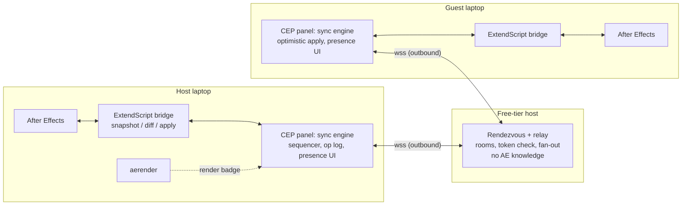

# 05 — Live collaborative After Effects session: architecture and plan

Date: 2026-10-10. All 15 input files were present and read; none modified. Citations are "file §section"; `adobe/NN` and `live-collab/NN` are the folders. Tags: **[unverified]**, **[snippet-only]**, **[uncertain]** are inherited from the source file. **[re-verified]+URL** means I re-checked it today (3 of 5 allowed checks used; Team Projects returned 403, so it stays unverified).

## 1. Product definition (and the tension, resolved)

**Product:** a CEP panel for After Effects that starts a *session* on one project. A friend joins with a code. Both people run their own AE on the same project, see each other's selected layer, playhead and every property change in a change feed, and edit simultaneously. The **host** approves joiners, orders all edits, and owns the final render.

**The tension.** IDEAS.md says "uses editor's machines… fastest GPU" (host streams a desktop). Collabify shows "two separate windows… each other's cursors" (state sync) (tiktok §~11s, §~15s). These are different products. Streaming gives one AE window, one mouse, no per-person views (live-collab/03 §8; live-collab/04 §Part C option 2). State sync gives two windows but each machine renders locally, so the "fast GPU" story is lost (live-collab/03 §8).

**Resolution: state sync is the product; "host" means authority, not pixels.**
- Host = (1) the sequencer that assigns revision numbers and accepts or rejects ops, (2) the machine holding the canonical project, (3) the machine that runs `aerender` for the final render and the "Rendering" badge. This is "host-authoritative" in live-collab/04 §Option 3 and live-collab/01 §Implications 1.
- The host's GPU is used for what it's actually good for: final renders and an optional stream, not live editing.
- Streaming (Parsec/Moonlight) is an optional "watch the host's screen" link, not built (live-collab/03 §11 item 7).
- Collabify is an animated promo with no product found (tiktok §Limits). **[re-verified]** a search today for "Collabify After Effects plugin" again found nothing: https://www.evercast.us/blog/how-to-collaborate-adobe-after-effects (closest hit; not Collabify). Treat it as a feature reference only.

## 2. Why this idea (evidence for)

| Evidence | Source | Strength |
|---|---|---|
| Adobe is single-user-first; Figma (+48% YoY, 136% NDR) and Canva (265M MAU) own multiplayer | adobe/04 §3 item 4 | **Medium**: vendor/earnings coverage, but the claim is a judgement |
| Adobe's own AE collaboration is Team Projects (copies, locking, merge) and Frame.io (review on rendered cuts), not live co-editing | live-collab/04 §A6, §B2 | **Medium**: Team Projects status **[snippet-only]**/[uncertain] |
| No third-party live co-editing for AE found | live-collab/04 §A6 | **Weak–medium**: negative search result |
| "Live or real-time/multiplayer creative collaboration beyond comments" appears under-served in Adobe hackathon winners | adobe/07 §4.2 | **Weak**: author labels it "my inference… not a verified market study" |
| Collaboration is the *weakest* documented Adobe pain point | adobe/02 §1 rank 9: "Weak: nothing found in this pass" | **Against us**: no demand evidence |
| AE is hard to learn; Collabify-style promo got 42.3K likes (counts unlabeled) | adobe/02 §7; tiktok | **Weak**: vendor opinion; unlabeled counts |
| Adobe winners: live inside an Adobe surface, one persona, ship intent, responsible-AI beat | adobe/07 §4.1 | **Strong** (read pages), fits 3 of 4 |
| Adobe wants agents/assistants in apps; AE assistant is in private beta | adobe/03 §2; adobe/05 §1 | **Medium**: shows direction; not collaboration |
| Collaboration Catalyst prize existed (SaySo: voice feedback to tasks) | adobe/07 §2.1 | **Medium**: Adobe values collaboration glue |
| Academia: CADament shows watching others' screens transfers skill; CSI measures "Collaboration"; COFI and the agency review stress two-way control; provenance (Adobe CAI) | adobe/06 #22, #2, #5, #6, #24 | **Weak–medium**: none studies live co-editing |
| Precedents work: Figma, Blender Multi-User, Unreal Multi-User | live-collab/04 §B1, §B4, §B6 | **Strong** for feasibility of the pattern |
| Layer Puppet + Band: wow high, use case scored 2/5, Adobe pattern weak, "no persona" | adobe/08 §(c), §(g) | Comparison below |

**Versus Layer Puppet + Band (adobe/08).** That idea scored 5 on track prompt, 2 on use case and 1 on "inside an Adobe surface" (adobe/08 §(c)). This idea inverts the profile: it lives inside AE (an Adobe surface, **1→5**), has a nameable persona (two motion designers or an editor and a client-side animator), and a concrete workflow. It is weaker on "make something people feel" and has no AI (see §3). Both ideas share the demo-reliability risk (adobe/08 §(e) item 7).

Honest read: demand evidence is thin (adobe/02 rank 9), but fit with Adobe's pattern and feasibility evidence is better than for Layer Puppet.

## 3. Steelman against

| Objection | Source | Mitigation |
|---|---|---|
| **Creative-track fit.** Track says "make something people feel… interactive art, music, games" (CLAUDE.md §Tracks); this is a productivity tool | CLAUDE.md | Demo *feel*: two people co-animate a title live. Add a "Motion Duel" stretch (CADament-style, adobe/06 #22). Partial |
| **No AI, no responsible-AI beat**, which Adobe has rewarded (adobe/07 §2.2, §4.3 item 5) | adobe/07 | Authorship/attribution log as provenance-lite (adobe/06 #24, #8: pride in craft). Optional AI peer whose ops are labeled. Partial |
| **Prior art:** Team Projects, Frame.io, AE AI Assistant, Collabify | live-collab/04 §A6; adobe/03 §2 | Differentiate: simultaneous, per-person presence, vs copies/locks and post-render review. Team Projects claim **unverified** (live-collab/03 §6 says "cloud-synced comps"; live-collab/04 §A6 says copies/locks). Partial |
| **AE API limits:** no change events, no stable IDs, no shared undo, no cursor API | live-collab/04 §A2, §A8. **[re-verified]** `Application` docs list only `onError` as a callback: https://ae-scripting.docsforadobe.dev/general/application/ | Diff-polling + own IDs + local-only undo + selected-layer "cursor". Mitigated by scoping |
| **Both users need AE licenses and identical assets/AE version/plugins** | live-collab/04 §Option 1; live-collab/03 §8 | Bundled demo project (Collect Files), built-in effects only. Unmitigated for real users |
| **Demo reliability:** two laptops, venue Wi-Fi, polling lag, AE crash risk (200 ms polling crashed AE on big projects, one report **[snippet-only]**) | live-collab/03 §6 | Tiny project, 4 Hz, prerecorded fallback video. Partial |
| **Security:** remote ops execute as scripts on host | live-collab/03 §4 | Op allow-list (numeric property sets only), host approval, single-use invite, WSS. Mitigated |
| **CEP→UXP.** **[re-verified]** UXP public beta for AE "by November 2026"; CEP disabled by default Dec 2028, removed Dec 2029; "ExtendScripts are not affected": https://blog.developer.adobe.com/en/publish/2026/09/investing-in-the-future-of-creative-cloud-extensibility-uxp-comes-to-our-flagship-applications | live-collab/04 §A3 | CEP works today; keep logic in ExtendScript and a transport module so UXP port is a pitch line. UXP AE API surface unknown **[uncertain]** |
| **Demand is unproven** | adobe/02 §1 | Run 3 interviews with AE users at the event. Unmitigated until done |

## 4. Design inspiration map

| Mechanism | Source | After Effects feature |
|---|---|---|
| Central server orders ops, revision numbers | live-collab/01 §3 | Host assigns `rev` to every op |
| OT transform functions | live-collab/01 §Implications | **N/A:** transform functions per AE op pair not feasible in a day; use per-property LWW (live-collab/01 §Implications; live-collab/04 §B1) |
| Optimistic local apply, one op in flight + composed buffer | live-collab/01 §2.4, §4 | Guest applies instantly; scrub drags are coalesced into one `set` per property per tick |
| Presence/cursors in per-user color, ephemeral | live-collab/01 §5 | Colored badge on each person's selected layer, playhead marker, avatar list. Not persisted |
| Suggestions (`SUGGEST` write mode) | live-collab/01 §9 | Stretch: "Suggest" role queues ops for host accept |
| Comments, anchored | live-collab/01 §12 row 11 | Timeline comments as comp markers (marker API, live-collab/04 §A8) |
| Version history / revision log | live-collab/01 §3; live-collab/02 §3.6 | Op log with revision numbers → "restore to rev N" by replaying inverse sets (stretch) |
| AutoSave | live-collab/02 §3.6 | Host autosaves `.aep` every N seconds as recovery point. Not a sync mechanism |
| Co-authoring locks vs lock-free merge | live-collab/02 §3.4, §7 item 3 | **Soft per-layer lock** shown in presence (Word shipped locks ~15 years; Resolve locks bins/timelines, live-collab/04 §B3) |
| Offline / reconnect | live-collab/01 §6; live-collab/02 §7 item 9 | Reconnect catch-up only: "last rev N" → missed ops or fresh snapshot (live-collab/03 §5). Long offline merge **N/A**: ops not transformable |
| Permissions / share links | live-collab/01 §9 | Host, editor, viewer roles; single-use invite code + host approval (live-collab/03 §4) |
| Desktop/web interop via file-format contract | live-collab/02 §7 item 10 | Shared JSON schema; ExtendScript adapter on each AE. Optional web viewer |
| Per-user undo | live-collab/01 §3; live-collab/04 §B1 | Stretch: undo = send inverse of *my* last op. Real AE undo stack **N/A** (no API, live-collab/04 §A8) |
| Realtime API shut down after ~6 yrs | live-collab/01 §10 | Lesson: build one tight demo, not a platform |

## 5. System architecture

**Message protocol** (JSON over one WSS; envelope `{v, room, from, type}`):

| Type | Fields | Channel |
|---|---|---|
| `join` / `join_request` / `approve` | code, name, color, role | reliable |
| `snapshot` | rev, comp tree: comps → layers `{uid,name,index,parent,in,out}` → watched props `{path,value}` | reliable |
| `op` | opId, baseRev, author, kind (`set`, `addKey`, `rename`), target `{compUid, layerUid, path[matchName…]}`, value | reliable, guest→host |
| `commit` | rev (host-assigned, gap-free), the op | reliable, host→all |
| `reject` | opId, reason (`locked`, `not_allowed`, `stale`) | reliable |
| `lock` / `unlock` | layerUid, user | reliable |
| `presence` | user, compUid, selectedUids[], playhead, ts | **lossy, 5–10 Hz, never logged** |
| `render` | status, pct | reliable |
| `resume` | lastRev | reliable |

Presence is dropped-OK and throttled; edits are ordered and logged (split recommended in live-collab/03 §3.1, §5; live-collab/01 §5).

**Data model.** AE gives no stable cross-machine IDs (live-collab/04 §A8). Mint a `layerUid` and store it in `Layer.comment` as `[cu:xxxx]`; same for comps. Whether the tag survives duplicate/precompose is **untested** (live-collab/04 §Open questions c). Property path = chain of `matchName`s (stable, non-localized, live-collab/04 §A2), e.g. `["ADBE Transform Group","ADBE Position"]`. Footage is not synced; both sides open the same Collect Files folder (live-collab/04 §7).

**Sync algorithm** (Figma-style, host as the per-document authority; live-collab/04 §B1, live-collab/02 §7 item 5):
1. Host holds `rev` and an append-only op log, plus a periodic snapshot (Word "revisions", Fluid "summaries": live-collab/02 §7 item 8).
2. Guest applies its own `op` immediately, sends it; while unacked, ignores incoming `commit`s for the same `(layerUid, path)` to avoid flicker.
3. Host validates (allow-list, role, lock), assigns `rev`, applies via ExtendScript inside `beginUndoGroup`, broadcasts `commit`. Property-level last-writer-wins in host order; per-layer soft lock (set on selection) prevents most collisions.
4. **Echo suppression:** every remote apply sets an `applying` flag and records `lastApplied[(uid,path)]=value`. The poll diff discards changes equal to that value or occurring during the flag. Each commit carries its `opId`; a local diff matching a pending opId is not re-sent (live-collab/04 §Option 1 cons).
5. **Change detection:** `scheduleTask` loop (**[re-verified]** exists, same URL as above) at ~4 Hz diffs only: selection, playhead, active comp's layer list (cap ~50 layers), and a watched set of transform/opacity props. 200 ms polling crashed AE on large projects in one report **[snippet-only]** (live-collab/03 §6); 2–5 Hz is **[uncertain: untested]**.
6. **Reconnect:** `resume{lastRev}` → missed commits or a fresh snapshot (live-collab/03 §5).

## 6. Host-local vs server decision

Scores 1–5, my judgement adapted from live-collab/03 §9 (itself "my judgement, not measured"). Weights reflect a one-day demo on strange Wi-Fi.

| Criterion (weight) | A. Cloud server | B. Host-local, guest dials host | C. Hybrid relay + host-authoritative | D. Stream GPU desktop |
|---|---|---|---|---|
| Setup friction (×3) | 4 | 2 | **5** | 3 |
| Hackathon feasibility (×3) | 3 | 2 | **5** | 4 |
| Reliability (×2) | 4 | 2 | 4 | 3 |
| Fit to Collabify (×2) | 4 | 4 | 4 | **1** |
| Latency, cost, security, GPU use (×1 each) | 3,2,4,1 | 3,5,2,3 | 4,4,4,3 | 3,5,3,5 |
| **Weighted total /70** | 47 | 37 | **61** | 45 |

**Recommendation: C.** Both laptops dial *out* over `wss://` to a ~100-line Node `ws` relay; the host's panel is the authority. Reasoning: outbound-only connections are the only thing that reliably works across arbitrary networks (live-collab/03 §3.3); the relay never parses AE content (live-collab/01 §Implications 1). Disagreement resolved: live-collab/02 §7 item 5 lets the host *run* the ordering service, which would make the host reachable-by-guests (option B); live-collab/03 §11 and live-collab/04 §Option 3 keep the host as *logical* authority behind a relay. We take the latter.

**"Hosting locally" concretely for the demo:**
- Host's *panel* is authority; the relay runs on the host's own laptop only if needed (see fallback), otherwise on any free host. Test WebSockets on whichever host you pick; Cloudflare Quick Tunnel docs don't confirm WebSocket support (live-collab/03 §3.3, §11 item 8).
- Venue Wi-Fi may isolate clients **[uncertain, unsourced]** (live-collab/03 §3.3); outbound-only to the relay sidesteps it.

**Fallback ladder:** (1) relay on free host; (2) host runs relay locally and exposes it via `cloudflared` quick tunnel (hostname changes each run; 200 in-flight cap; test WS) or ngrok free (1 GB/month, interstitial) (live-collab/03 §3.3); (3) phone hotspot, both laptops on it, relay on host LAN IP; (4) Tailscale, tiny JSON only (live-collab/03 §3.3); (5) prerecorded demo video plus Parsec/Moonlight screen share for live Q&A.

## 7. Components: build / buy / borrow

| Component | Decision | Owner skill | Risk |
|---|---|---|---|
| CEP panel shell, `CSInterface`, debug mode | Borrow: AE MCP repos for working panel + JSX bridge, check licenses (live-collab/04 §A7) | JS/CEP | Med: unsigned panel needs `PlayerDebugMode` **[snippet-only]** |
| ExtendScript bridge (snapshot, diff, apply, tagging) | **Build** (core) | ExtendScript/AE scripting | **High**: ES3, UI blocking, no events |
| Sync engine (seq, op log, LWW, locks, echo suppression) | Build (small); borrow design from Figma | Distributed-systems JS | Med |
| Relay | Build 100 lines (`ws`), or buy Liveblocks/PartyKit **[snippet-only]** (live-collab/04 §B8) | Node | Low |
| Invite/auth | Build: 6-char code, TTL, host approve, rate limit | Node | Low |
| Asset handling | Borrow: AE Collect Files → shared zip/folder, bundled demo | AE user | Med: path mismatch, fonts, version |
| Presence UI | Build in panel HTML | Front end | Low |
| Change feed | Build from op log | Front end | Low |
| Render badge | Borrow `aerender`; spawn from Node in panel; needs a saved copy. Official page 403, details **[uncertain]** (live-collab/04 §A5) | AE/CLI | Med |
| Optional stream | Buy: Parsec/Moonlight link only (live-collab/03 §11 item 7) | none | Low |
| CRDT/OT library | Skip (Yjs only for expression text, stretch; live-collab/01 §Implications) | — | — |

## 8. Feature tiers

**MVP (one day):** create/join with code, host approval; snapshot on join; presence (selected layer badge + playhead + avatars); bidirectional sync of transform props and opacity with host ordering; soft per-layer lock; change feed with author names (attribution); render badge via `aerender`; reconnect with `resume`.

**Stretch:** markers as comments; per-user undo via inverse `set`; revision list + restore; Suggest role; Viewer role; mock-cursor animation in the layer panel if real presence looks flat; AI peer whose ops are labeled "AI" (rhymes with adobe/03 §2 agents and adobe/06 #5, #6); Motion Duel mode (adobe/06 #22); direct WebRTC upgrade (live-collab/03 §11 item 7a); Parsec link.

**Ruled out:**
| Item | Why |
|---|---|
| Shared undo/redo stack | no read access to history (live-collab/04 §A8) |
| `.aep` merge | opaque binary (live-collab/04 §A1) |
| Pixel mouse cursor in AE canvas | no API (live-collab/04 §Part C; live-collab/03 §8) |
| OT/CRDT over keyframe curves | "real work" (live-collab/02 §7 item 9) |
| Lockstep | AE not deterministic (live-collab/03 §5) |
| C++ AEGP | not hackathon-feasible (live-collab/04 §A4) |
| Long offline divergence | ops not transformable (live-collab/01 §Implications) |
| Arbitrary 3rd-party effect params | diverge (live-collab/04 §Option 1) |
| Generic platform / 50 editors | Realtime API lesson (live-collab/01 §10) |

## 9. 3-minute demo and Q&A

| Time | Beat | Rubric / Adobe criterion |
|---|---|---|
| 0:00–0:25 | "Two motion designers, one project, today they pass `.aep` files back and forth." Show Team Projects/Frame.io are copies or post-render review (live-collab/04 §A6) | Clear use case; Adobe "one persona, one pain" (adobe/07 §4.3 item 1) |
| 0:25–0:50 | Both panels "Not connected"; host clicks Invite, guest enters code, host approves → "Connected" | Polish; mirrors Collabify's own beat (tiktok §~11–15s) |
| 0:50–1:50 | Live: guest drags Hero Title, host sees it move; each sees the other's selected-layer badge and playhead; lock on the layer the other is editing | Track prompt (feel); Adobe "inside an Adobe surface" |
| 1:50–2:15 | Change feed ("Sam moved Hero Title") = authorship attribution; if AI peer built, its ops are labeled | Responsible-AI/provenance beat (adobe/07 §4.3 item 5) |
| 2:15–2:35 | Host hits Render; badge + avatars. "Fast GPU hosts the render" | Resolves the host's GPU story |
| 2:35–3:00 | Ship intent: CEP today, UXP beta Nov 2026, Marketplace (**[re-verified]** UXP link above); next: assets sync | Adobe feasibility/ship intent (adobe/07 §4.1) |

**Q&A prep**
- *Why not Team Projects?* Copies and locks, not simultaneous (live-collab/04 §A6; **unverified**, say "as we understand it").
- *Why not stream the screen?* One cursor, one window, no per-person views (live-collab/04 §Option 2).
- *What if two people edit the same property?* Host order wins; lock prevents it for layers (live-collab/02 §7 items 3–4).
- *Do you sync the project file?* No, ops only; `.aep` is opaque (live-collab/04 §A1).
- *Is Collabify real?* We found no product; we treat it as a feature reference (tiktok §Limits).
- *Security?* Allow-list, host approval, WSS (live-collab/03 §4).
- *Where's the AI?* Honest: core is not AI; attribution log and optional labeled AI peer. Don't claim more.
- *Does it scale?* 2–4 people by design (live-collab/01 §Implications).
- *Will CEP die?* Dec 2028/2029; ExtendScript unaffected ([re-verified]).

## 10. First-2-hours kill tests and open questions

**Kill tests (stop and re-plan if failed):**
1. **Panel + WebSocket:** a CEP panel on the team's AE version opens a `wss` connection and round-trips a message in 30 min (Brandkick pattern suggests yes: live-collab/04 §A7). Fail → file-based bridge as in p10q/ae-mcp, or kill.
2. **Apply:** `setValue` on position from a received message, wrapped in an undo group, within 30 min.
3. **Poll cost:** diff 50 layers at 4 Hz with no visible jank or crash (live-collab/04 §Open questions a). Fail → drop to button/focus refresh.
4. **Echo:** two instances ping-pong a drag without feedback loop or flicker.
5. **Tag survival:** `[cu:]` in `Layer.comment` survives duplicate/precompose (live-collab/04 §Open questions c). Fail → restrict demo to named, non-duplicated layers.
6. **Network:** WSS works from venue Wi-Fi to the chosen relay; else switch to hotspot.

**Open questions for the team:** Does everyone have AE installed and licensed? Which AE version(s) (CEP/UXP, multi-frame rendering)? Is CEP debug mode settable on both machines? "Allow Scripts to Write Files and Access Network" enabled (live-collab/04 §A2)? Asset approach: Collect Files zip or shared folder? Is the guest on Mac or Windows (path separators)? Who knows ExtendScript? **Ask Adobe staff:** are AE licenses/CEP signing provided? Is there an AE UXP beta build? Any AE team members who know of a Collabify-like product? (adobe/01 §8 says to ask about credentials; nothing in the files covers AE licensing.)

## 11. Contradictions, gaps, unverified

| Item | Files | Resolution |
|---|---|---|
| Who runs the ordering service: host (reachable) vs relay + host logical authority | live-collab/02 §7 item 5 vs live-collab/03 §11, live-collab/04 §Option 3 | Chose relay (§6) |
| Option labels differ (A/B/C/D vs A/B/D/E) | live-collab/03 §2, §9 vs task | Same four options; §6 relabeled |
| UXP-for-AE status: "beta on Adobe's site" vs "public beta by Nov 2026" | live-collab/03 §6 vs live-collab/04 §A3 | **[re-verified]**: public beta *by* Nov 2026 (not yet public as of today); AE UXP API surface still unknown |
| Poll rate: 200–500 ms vs 2–5 Hz | live-collab/04 §Option 1 vs live-collab/03 §11 | Pick 4 Hz; test in kill test 3 |
| Team Projects: "cloud-synced comps" vs "not simultaneous; copies/locking" | live-collab/03 §6 vs live-collab/04 §A6 | **Unresolved.** Official page 403 today; all sources vendor/**[snippet-only]**. Don't assert status on stage |
| Cursor: "labeled cursor" (promo) vs no cursor API | tiktok §~15s vs live-collab/04 §Part C | Selected-layer badge as proxy; mock if needed |
| "Music & Audio under-served" vs "occupied" (irrelevant here, but shows adobe/07 §4.2 inference is shaky) | adobe/07 §4.2 vs §3.1; adobe/08 §(b) #11 | Treat "live collaboration is under-served" as weak |
| Parsec latency: <10 ms encode vs ~90.6 ms total | live-collab/03 §3.4 vs live-collab/04 §B9 | Both can hold (encode vs end-to-end) |

**Gaps (not in any file):** demand for live AE co-editing; AE licensing for teammates; a Hacklanta-specific Adobe rubric (adobe/07 §1, adobe/08 §(b) #14); whether Adobe staff supply AE or credentials; `aerender` details (403, **[uncertain]**); Word's real-time transport and lock-free algorithm (live-collab/02 §6); any measured polling cost; whether `Layer.comment` tagging works; Collabify's real implementation (does not appear to exist).

**Still unverified after my re-checks:** Team Projects status, Frame.io V4 panel state, `aerender` specifics, AEGP behavior, all Parsec/Moonlight numbers, Liveblocks/PartyKit pricing.

DONE /Users/jakecashion/Dev/personal/hacklanta/research/live-collab/05-architecture-and-plan.md
